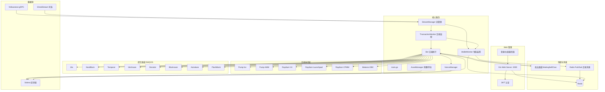
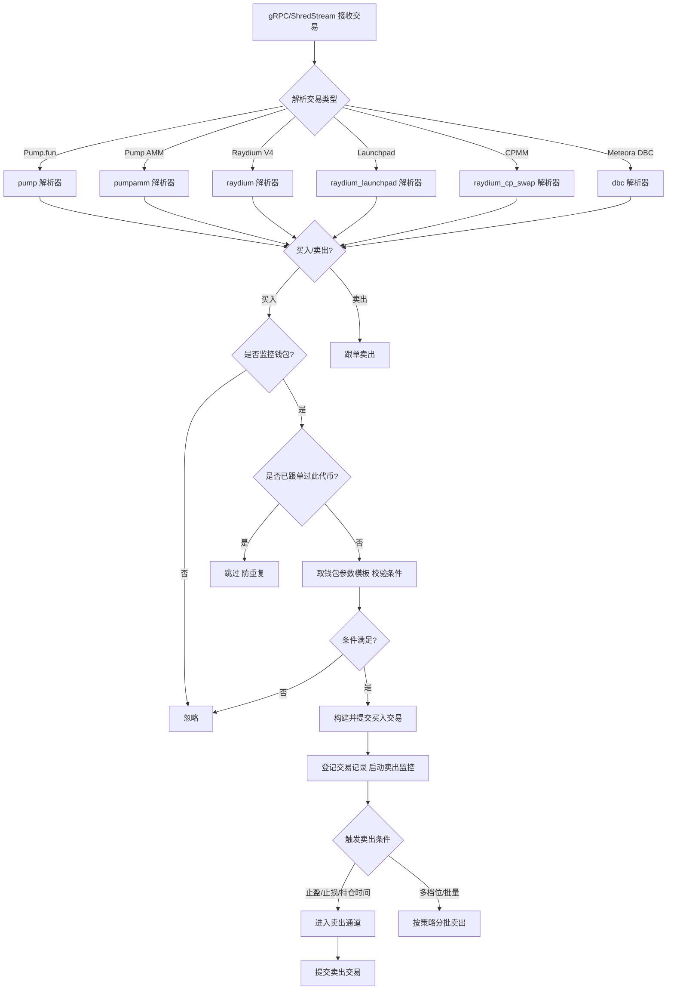

# copy-trade-bot

Solana 聪明钱包跟单交易机器人（Copy Trading Bot）。通过 Yellowstone gRPC / ShredStream 实时订阅链上交易数据，识别"聪明钱包"的买卖行为并自动跟单，覆盖 Pump.fun、Pump AMM、Raydium V4、Raydium Launchpad、Raydium CPMM、Meteora DBC 等主流交易平台。

## 功能特性

- **毫秒级跟单**：Yellowstone gRPC 实时订阅交易流，可选 ShredStream 数据源进一步降低 50–200ms 延迟（当前仅支持 Pump.fun 内盘，默认关闭）
- **多钱包独立策略**：每个被监控钱包可单独配置止盈 / 止损 / 持仓时间 / 跟卖开关 / 风险等级（高频、低频钱包分类管理）
- **参数模板（Param Scheme）**：可复用的交易参数组合（买入金额、滑点、优先费、小费、止损止盈等），按钱包绑定，支持默认模板
- **多级卖出策略**：延迟卖出（delay_sell）、多档位止盈卖出（multi_sell）、批量阶梯卖出（batch_sell）
- **防重复交易**：同一代币对每个触发钱包只交易一次（可配置 `repeat_trade_enable` 放开）
- **风控机制**：止盈 / 止损 / 持仓时间触发、本金抽回（capital recovery）、盈利目标监控、买单活跃度监控（Pump.fun 内盘）、地址与代币黑名单
- **多通道交易提交（SWQOS）**：Jito、NextBlock、Temporal、bloXroute、Zeroslot、Blockrazor、Astralane、Flashblock 等区块引擎路由，买卖可分别启用
- **Nonce 账户加速**：nonce account + 全局 blockhash 缓存，减少交易提交延迟
- **Web 管理后台**：Gin + JWT 认证，钱包管理、私钥导入、配置热更新、参数模板、黑名单管理
- **事件去重**：ShredStream 场景下的 LRU 事件去重缓存
- **模拟模式**：`simulate_mode` 支持只模拟不下单

## 系统架构



### 跟单交易流程



## 支持的交易平台

| 平台 | 代码目录 | 说明 |
| ---- | -------- | ---- |
| Pump.fun | `pump/` | 内盘（Bonding Curve）买卖，含内盘迁出（migrate） |
| Pump AMM | `pumpamm/` `pumpammV2/` | Pump.fun 外盘 AMM 池 |
| Raydium V4 | `raydium/` | Raydium 经典 AMM |
| Raydium Launchpad | `raydium_launchpad/` | 新币发行 / 打新池 |
| Raydium CPMM | `raydium_cp_swap/` | Raydium CPMM（集中流动性） |
| Meteora DBC | `dbc/` `dbcv2/` | Meteora Dynamic Bin Curve |
| Meteora DLMM | `lb_clmm/` | 协议层封装（Liquidity Book） |

以上 DEX 协议包均由 [anchor-go](https://github.com/gagliardetto/anchor-go) 从 IDL 生成。

## 目录结构

```
copy-trade-bot/
├── main.go                  # 入口：初始化配置/Redis/监控器/Bot/流管理/Web
├── config/
│   └── config.yaml          # 主配置文件（密钥、RPC、策略、SWQOS 通道）
├── bot/                     # 交易执行：各平台买卖、卖出策略、盈利/活跃度监控
├── core/                    # TraderImpl 交易构建核心、事件合并、参数校验
├── stream/
│   └── manager.go           # 流管理：gRPC/ShredStream 订阅、重连、健康检查
├── wallet/                  # 钱包监控、交易监控、参数模板、黑名单、Redis 服务
├── web/                     # Gin Web 后台（server/auth/各 controller + static 前端）
├── swqos/                   # 多区块引擎提交路由（Jito/NextBlock/…）
├── sdk/                     # Redis 交易订阅 SDK（即时/延迟消息）
├── subscribe/               # Redis Pub/Sub 订阅服务
├── queue/                   # 卖出通道（WaitingSellChan/TokenSellChan）
├── noncecache/              # Nonce 账户管理、全局 blockhash 缓存
├── asset/                   # 余额/持仓管理
├── global/                  # 全局配置与内存映射
├── helpers/ calculator/     # 计算单元、AMM 数量/账户计算
├── types/ utils/ logger/ math/ constants/ common/
├── yellowstone_geyser/      # Yellowstone gRPC proto 封装
├── shredstream/             # ShredStream 客户端与 Pump.fun 解析
├── test/                    # 单元测试（calculator/AMM/pumpV2/Redis）
└── docs/                    # 架构与各功能实现/修复文档
```

## 快速开始

### 环境要求

- Go 1.24+（`go.mod` 声明 `go 1.24.1`）
- Redis（本地 `localhost:6379`，可用 `redis_db` 指定库）
- 一个 Solana 主网 RPC 与 Yellowstone gRPC 端点
- 交易钱包私钥（Base58）

### 构建

```bash
go build -o copytradeV7.1.1 .
```

仓库根目录已包含预编译二进制（`copytradeV7.0.8` ~ `copytradeV7.1.1-shredstream`），可直接使用；`copytradeV7.1.1-shredstream` 为最新版。

### 配置

编辑 `config/config.yaml`，至少需要：

```yaml
private_key: <你的交易钱包私钥(Base58)>   # 勿提交到公开仓库！
grpc_url: <Yellowstone gRPC 端点>
rpc_url: <Solana 主网 RPC>
```

按需开启平台开关（`pump_trade_enable` / `pump_amm_trade_enable` / `raydium_trade_enable` / `launchpad_trade_enable` / `meteora_dbc_trade_enable`），并在 Web 后台或 Redis 中配置监控钱包。

### 运行

```bash
./copytradeV7.1.1
```

或：

```bash
go run . 
```

> 注意：`main.go` 内置了 IP 白名单校验（`Authorize_IPs`），本机 IP 不在列表内会直接退出，部署时需按需修改。

## 配置说明（config.yaml）

### 全局

| 配置项 | 说明 |
| ------ | ---- |
| `private_key` | 交易钱包私钥（Base58） |
| `simulate_mode` | 模拟模式，只构造不下发 |
| `grpc_url` / `rpc_url` | 数据源与 RPC 端点 |
| `redis_db` / `redis_key_prefix` | Redis 库与键前缀 |
| `trade_channel` | Redis 交易消息通道，默认 `flashtrade:trade` |
| `web_port` | Web 后台端口，默认 3000 |
| `skip_create_nonce_account` / `nonce_account_pubkey` | 跳过创建 nonce 账户并指定已有账户 |
| `skip_ata_check` | 跳过 ATA 检查 |
| `compute_units` | 交易计算单元上限 |

### 平台开关与跟单条件

| 配置项 | 说明 |
| ------ | ---- |
| `pump_trade_enable` 等 5 项 | 各平台跟单开关 |
| `repeat_trade_enable` | 允许对同一代币重复跟单（默认 false 防重复） |
| `min/max_follow_trigger_amount` | 触发跟单的原始买单金额范围（SOL） |
| `min/max_pool_size` | 池子大小过滤（SOL） |
| `buy_sol_amount` | 全局单笔买入金额（SOL） |
| `buy/sell_slippage`、`buy/sell_priority_fee`、`buy/sell_tip_fee` | 全局滑点与费用（可被参数模板覆盖） |

### 卖出策略

| 配置项 | 说明 |
| ------ | ---- |
| `sell_mode` | `delay_sell`（延迟卖出）/ `multi_sell`（多档位） |
| `sell_delay_time` | 延迟卖出等待时间（ms） |
| `multi_sell_levels` | 多档位：`price_percent` 价格涨幅百分比 + `sell_percent` 卖出比例 |
| `batch_sell_config` | 批量卖出：`num_batches` 批次数 + `thresholds` 每批价格阈值（%） |
| `sell_interval_limit` | 卖出频率限制 |
| `capital_recovery_percent` | 本金抽回比例：达到该涨幅先卖出回收本金 |
| `profit_target_monitor` | 盈利目标监控：目标利润、检查间隔、超时清仓/部分卖出 |
| `buy_activity_monitor` | 买单活跃度监控（Pump.fun 内盘）：X 秒无新买单则卖出指定比例 |
| `dev_sell` / `dev_sell_tip` / `dev_sell_priority_fee` | 开发者跟卖（dev sell）开关与费用 |

### SWQOS 提交通道

`normal` / `jito` / `nextblock` / `temporal` / `bloXroute` / `zeroslot` / `blockrazor` / `astralane` / `flashblock` 九个通道，每个均支持：

```yaml
jito:
    buy_tip: 0.0001        # 买入 tip
    sell_tip: 0.0001       # 卖出 tip
    enable: true           # 买入启用
    sell_enable: true      # 卖出启用
    rpc_url: ...           # 区块引擎提交端点
    api_keys: [...]        # 服务商 API 密钥
```

### 数据源

```yaml
shred_stream:
    enabled: false         # 默认关闭，开启后从 Shred 流解析（仅 Pump.fun 内盘）
    endpoint: ...
    reconnect_interval: 5
    max_retries: 10
event_dedup:
    cache_size: 100000     # ShredStream 事件去重 LRU 缓存
    ttl_seconds: 60
```

### 日志

```yaml
logging:
    level: info            # debug/info/warn/error/fatal
    format: text           # text/json
    file: ""               # 空则输出到控制台
```

## 跟单策略

### 钱包设置

每个监控钱包（`wallet/` 中 `WalletSettings`，通过 Web 后台或 Redis 管理）：

- `Type`：`high_frequency`（高频）/ `low_frequency`（低频）—— 不同类别可配不同策略
- `TakeProfitPct` / `StopLossPct`：止盈 / 止损百分比
- `ExitTimeSec`：最长持仓时间（秒），触发即卖出（"2S 卖出"）
- `IsFollowSell`：是否跟卖（钱包卖出时同步卖出）
- `ParamSchemeID`：绑定的参数模板
- `Risk`：风险等级（high/medium/low），`Enabled`：启用开关

三个卖出条件（止盈 / 止损 / 持仓时间）任一触发即卖出。低频钱包可设"止盈 50%、止损 50%、持仓 5s"，高频钱包可设"止盈 20%、止损 20%、1s 卖出"，各自独立。

### 参数模板（Param Scheme）

模板字段：`SellDelayTime`、`Min/MaxFollowTriggerAmount`、`Min/MaxPoolSize`、`MaxBuyAmount`、`MinBuyAmount`、`BuySolAmount`、`SellPercentage`、`StopLossPercentage`、`TakeProfitPercentage`、`Buy/SellSlippage`、`Buy/SellPriorityFee`、`Buy/SellTipFee`。支持默认模板，钱包可单独绑定。

## Web 管理后台

默认端口 `3000`，`/login` 登录（用户凭据存储在 `users.json`，bcrypt 哈希，默认管理员账号 `admin10111`，请立即修改密码），`/dashboard` 管理页。

认证 API（JWT）：

- `POST /api/auth/login`、`POST /api/auth/verify`、`POST /api/auth/change-password`

业务 API（均需 JWT）：

| 分组 | 端点 |
| ---- | ---- |
| 配置 | `GET/POST /api/config`、`GET/POST /api/trade-settings`、`POST /api/restart-process`（supervisor 重启） |
| 钱包 | `GET/POST /api/wallets`、`GET/PUT/DELETE /api/wallets/:address`、`POST /api/wallets/import-private-key` |
| 参数模板 | `GET/POST /api/param-schemes`、`GET/PUT/DELETE /api/param-schemes/:id`、`GET /api/param-schemes/default`、`POST /api/param-schemes/default/:id` |
| 黑名单 | `GET/POST /api/blacklist`、`POST /api/blacklist/batch`、`GET/PUT/DELETE /api/blacklist/:address`、`DELETE /api/blacklist` |
| Redis 配置 | `POST /api/redis-config` |

## 部署

### Supervisor

```ini
[program:copytrade]
directory=/usr/local/server/copy-trade-bot
command=/usr/local/server/copy-trade-bot/copytradeV7.1.1-shredstream
autostart=true
autorestart=true
stderr_logfile=/var/log/copytrade.err.log
stdout_logfile=/var/log/copytrade.out.log
environment=CODENATION_ENV=prod
```

### Nginx 反向代理

```nginx
server {
    server_name bot.example.com;
    location / {
        proxy_set_header Connection '';
        proxy_http_version 1.1;
        chunked_transfer_encoding off;
        proxy_pass   http://127.0.0.1:3000;
        proxy_buffering off;
        proxy_cache off;
    }
}
```

## 测试

```bash
go test ./test/...
```

覆盖：AMM 计算器（`calculator_amm_test.go`）、Pump V2 账户解析（`pump_v2_accounts_test.go`）、Redis Pub/Sub（`redis_pubsub_test.go`）等。

## 相关文档

- `docs/ARCHITECTURE.md` — 系统架构详解
- `docs/SHREDSTREAM_INTEGRATION_PLAN.md` — ShredStream 集成方案
- `docs/PUMPAMM_V2_MIGRATION.md`、`docs/PUMP_VERSION_SELL_OPTIMIZATION.md` — 各平台实现说明
- `docs/TOKEN2022_ATA_FIX.md`、`docs/PUMPAMM_TOKEN2022_FIX.md` — Token-2022 兼容修复
- `BUY_ACTIVITY_MONITOR_README.md`、`CONCURRENCY_OPTIMIZATION.md` — 功能与并发优化说明
- `sdk/README.md` — Redis 交易订阅 SDK 使用说明


## 联系方式

Telegram 交流与技术支持，扫描下方二维码添加：


## 安全提示

- `config/config.yaml` 中的 `private_key`、各 SWQOS `api_keys`、RPC key 属敏感信息，**切勿提交到公开仓库**（仓库当前直接包含真实密钥，建议改用环境变量/密钥管理并轮换）
- `users.json` 为默认管理员凭据，部署后立即通过后台修改密码
- 本仓库为实盘交易软件，测试前建议先在 `simulate_mode: true` 下验证
